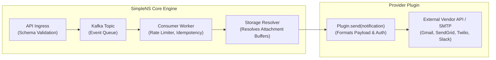
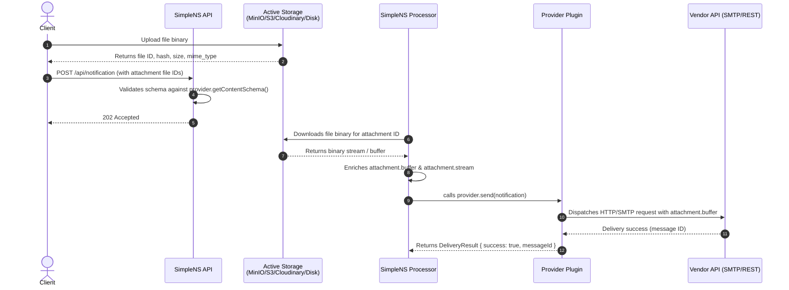

# @simplens/sdk

The official Software Development Kit for building notification provider plugins for **SimpleNS** (Simple Notification System).

---

## Table of Contents

- [Overview & Architecture](#overview--architecture)
- [Installation](#installation)
- [Core Building Blocks of a Provider Plugin](#core-building-blocks-of-a-provider-plugin)
  - [1. Provider Manifest](#1-provider-manifest)
  - [2. Recipient Schema](#2-recipient-schema)
  - [3. Content Schema & File Attachments](#3-content-schema--file-attachments)
  - [4. Dynamic File Attachment Configuration](#4-dynamic-file-attachment-configuration)
  - [5. How SimpleNS Delivers File Content to Plugins](#5-how-simplens-delivers-file-content-to-plugins)
  - [6. Handling Template Variables](#6-handling-template-variables)
  - [7. Complete Provider Lifecycle Methods](#7-complete-provider-lifecycle-methods)
  - [8. Error Handling & Retry Policies](#8-error-handling--retry-policies)
- [Complete Reference Implementation](#complete-reference-implementation)
- [API Reference](#api-reference)

---

## Overview & Architecture

SimpleNS operates on a decoupled architecture where the **core engine** handles enterprise infrastructure concerns and **plugins** handle external delivery logic:



| Responsibility | Handled By | Details |
|---|---|---|
| **Rate Limiting & Throttling** | SimpleNS Core | Leaky/Token Bucket rate limits per provider token |
| **Retry & Exponential Backoff** | SimpleNS Core | Automatic retries with jitter and fallback provider routing |
| **Idempotency & Deduplication** | SimpleNS Core | Redis-backed distributed deduplication across requests |
| **Attachment Storage & Hydration** | SimpleNS Core | Downloads files from MinIO, S3, Cloudinary, etc., before delivery |
| **Delivery Transport** | **Provider Plugin** | Constructs vendor-specific requests, signs auth, and executes send |
| **Payload Contracts & Validation**| **Provider Plugin** | Defines recipient schema and content schema using Zod |

---

## Installation

```bash
npm install @simplens/sdk zod
```

> [!NOTE]
> `zod` is re-exported by `@simplens/sdk` for convenience (`import { z } from '@simplens/sdk'`), so you do not need to install it separately if you prefer importing directly from the SDK.

---

## Core Building Blocks of a Provider Plugin

Every SimpleNS provider plugin implements the `SimpleNSProvider` interface. Here are the essential building blocks required to build a compliant plugin.

---

### 1. Provider Manifest

The `manifest` provides declarative metadata about the plugin, its required credentials, optional configuration flags, and baseline file attachment limits.

```typescript
import { ProviderManifest, STANDARD_ATTACHMENT_OPTIONAL_KEYS } from '@simplens/sdk';

export const manifest: ProviderManifest = {
  name: 'simplens-plugin-nodemailer-gmail',
  version: '1.0.0',
  channel: 'email', // 'email' | 'sms' | 'push' | 'whatsapp' | 'chat'
  displayName: 'Gmail (Nodemailer)',
  description: 'Send emails via Gmail SMTP using Nodemailer',
  author: 'Your Name <you@example.com>',
  homepage: 'https://github.com/YourOrg/plugin-nodemailer-gmail',

  // Credential keys that administrators must configure (stored encrypted at rest)
  requiredCredentials: ['EMAIL_USER', 'EMAIL_PASS'],

  // Optional configuration keys administrators can tune per provider instance
  optionalConfig: [
    'EMAIL_HOST',
    'EMAIL_PORT',
    'EMAIL_FROM',
    ...STANDARD_ATTACHMENT_OPTIONAL_KEYS, // Enables dynamic attachment tuning
  ],

  // Baseline file attachment constraints
  fileAttachment: {
    enabled: true,
    maxFileSize: 18 * 1024 * 1024, // 18 MB default
    maxCount: 10,
    allowedMimeTypes: [
      'text/plain',
      'application/pdf',
      'image/jpeg',
      'image/png',
      'video/mp4',
    ],
  },
};
```

---

### 2. Recipient Schema

The recipient schema defines and validates addressing information required by the vendor before a notification is accepted by SimpleNS.

The SDK provides base schemas for all standard channels:

```typescript
import {
  baseRecipientSchema,       // { user_id: string }
  emailRecipientSchema,      // { user_id: string, email: string (email format) }
  smsRecipientSchema,        // { user_id: string, phone: string }
  whatsappRecipientSchema,   // { user_id: string, phone: string }
  pushRecipientSchema,       // { user_id: string, device_token: string }
} from '@simplens/sdk';
```

#### Custom Recipient Extension
If your provider requires custom addressing fields (e.g., Slack webhook URL, Discord channel ID, or WebPush keys), extend `baseRecipientSchema`:

```typescript
import { z, baseRecipientSchema } from '@simplens/sdk';

// Example: Slack Recipient Schema
export const slackRecipientSchema = baseRecipientSchema.extend({
  webhook_url: z.string().url().optional(),
  channel_id: z.string().min(1).optional(),
}).refine(data => data.webhook_url || data.channel_id, {
  message: 'Either webhook_url or channel_id is required',
});
```

The provider exposes this via `getRecipientSchema()`:

```typescript
getRecipientSchema() {
  return emailRecipientSchema;
}
```

---

### 3. Content Schema & File Attachments

The content schema validates the payload sent under `content.<channel>` (e.g. `content.email`). SimpleNS enforces this schema **synchronously at API ingress** and **asynchronously before worker delivery**.

#### Built-in Content Schemas
- `emailContentSchema`: `{ subject?: string, html?: string, text?: string, attachments?: FileAttachmentItem[] }`
- `smsContentSchema`: `{ message: string (max 1600 chars) }`
- `whatsappContentSchema`: `{ message: string }`

#### File Attachments in Content Schema
Attachments are represented by the `FileAttachmentItem` structure:

```typescript
export interface FileAttachmentItem {
  id: string;          // SimpleNS storage file ID
  filename: string;    // e.g. "invoice.pdf"
  mime_type: string;   // e.g. "application/pdf"
  size: number;        // Size in bytes
  hash: string;        // SHA-256 content checksum
  url?: string;        // Optional direct URL
  metadata?: Record<string, unknown>;
  buffer?: Buffer;     // Binary Buffer hydrated by SimpleNS before delivery
  stream?: NodeJS.ReadableStream | Buffer; // Stream hydrated by SimpleNS
}
```

#### Defining Attachment Schemas
You can use `fileAttachmentArraySchema` for unrestricted attachments, or `createFileAttachmentArraySchema(config)` to enforce provider-specific constraints:

```typescript
import { z, createFileAttachmentArraySchema, FileAttachmentConfig } from '@simplens/sdk';

export function buildContentSchema(config?: FileAttachmentConfig) {
  return z.object({
    subject: z.string().optional(),
    message: z.string(),
    // Validates attachment count, max file size, and allowed MIME types with clear error messages
    attachments: createFileAttachmentArraySchema(config).optional(),
  });
}
```

When an attachment violates constraints, `createFileAttachmentArraySchema` emits precise error messages:
- **Attachments disabled**: `"File attachments are disabled for this provider"`
- **Unsupported MIME**: `"Attachment 'archive.xyz' has unsupported MIME type 'application/x-xyz'. Allowed types for this provider: application/pdf, image/*."`
- **File size exceeded**: `"Attachment 'report.pdf' (25 MB) exceeds maximum allowed size of 10 MB for this provider."`
- **Count exceeded**: `"Cannot attach more than 5 files (limit exceeded)"`

---

### 4. Dynamic File Attachment Configuration

SimpleNS allows administrators to configure attachment limits globally in the plugin `manifest`, and override them per provider instance using provider `options` in the dashboard (simplens version > 1.3.0 manages plugin configuration and management in the dashboard, api and mcp server) or in a .yaml config file (not recommended)

#### Standard Configuration Keys
Import `STANDARD_ATTACHMENT_OPTIONAL_KEYS` in your manifest's `optionalConfig`:

```typescript
import { STANDARD_ATTACHMENT_OPTIONAL_KEYS } from '@simplens/sdk';

// Exposes:
// - ATTACHMENT_MAX_FILE_SIZE (e.g. "25MB", "10KB", 26214400)
// - ATTACHMENT_MAX_COUNT (e.g. 5, 20)
// - ATTACHMENT_ALLOWED_MIME_TYPES (e.g. "application/pdf,image/*" or array)
// - ATTACHMENT_ENABLED (e.g. true, false)
```

#### Merging Defaults and Overrides in `initialize()`
Use `resolveFileAttachmentConfig(manifestConfig, options)` to merge manifest defaults with runtime administrator options:

```typescript
import { 
  SimpleNSProvider, 
  ProviderConfig, 
  FileAttachmentConfig, 
  resolveFileAttachmentConfig 
} from '@simplens/sdk';

export class MyProvider implements SimpleNSProvider {
  private effectiveAttachmentConfig?: FileAttachmentConfig;
  private dynamicContentSchema = buildContentSchema(manifest.fileAttachment);

  async initialize(config: ProviderConfig): Promise<void> {
    // 1. Resolve dynamic overrides from admin options
    this.effectiveAttachmentConfig = resolveFileAttachmentConfig(
      manifest.fileAttachment,
      config.options
    );

    // 2. Recompile dynamic content and notification schemas
    this.dynamicContentSchema = buildContentSchema(this.effectiveAttachmentConfig);
  }

  getContentSchema() {
    return this.dynamicContentSchema;
  }

  // Optional: Expose effective configuration back to SimpleNS dashboard and APIs
  getFileAttachmentConfig(): FileAttachmentConfig | undefined {
    return this.effectiveAttachmentConfig ?? manifest.fileAttachment;
  }
}
```

---

### 5. How SimpleNS Delivers File Content to Plugins

Plugin developers **do not need to download or fetch attachment files** from storage manually. SimpleNS handles the entire storage pipeline automatically:



#### Consuming Attachments in `send()`

When `provider.send(notification)` is called by the SimpleNS worker, each attachment in `notification.content.attachments` has been hydrated with:
- `att.buffer`: In-memory Node.js `Buffer` containing raw binary content.
- `att.stream`: Readable stream (`NodeJS.ReadableStream`) for streaming uploads.
- `att.url`: Optional signed or public URL (when supported by storage provider).

#### Example: Nodemailer (SMTP)
```typescript
const emailAttachments = [];
if (notification.content.attachments) {
  for (const att of notification.content.attachments) {
    if (att.buffer) {
      emailAttachments.push({
        filename: att.filename,
        content: att.buffer,
        contentType: att.mime_type,
      });
    } else if (att.url) {
      emailAttachments.push({
        filename: att.filename,
        path: att.url,
        contentType: att.mime_type,
      });
    }
  }
}
```

#### Example: HTTP Multipart / FormData API
```typescript
const formData = new FormData();
formData.append('to', notification.recipient.phone);
formData.append('message', notification.content.message);

if (notification.content.attachments) {
  for (const att of notification.content.attachments) {
    if (att.buffer) {
      const blob = new Blob([att.buffer], { type: att.mime_type });
      formData.append('files', blob, att.filename);
    }
  }
}

await axios.post('https://api.vendor.com/v1/send', formData);
```

---

### 6. Handling Template Variables

SimpleNS notifications support dynamic variables submitted via `notification.variables` (`Record<string, string>`).

#### Using `replaceVariables`
The SDK provides `replaceVariables(template, variables)` which replaces `{{var}}` placeholders:

```typescript
import { replaceVariables } from '@simplens/sdk';

const text = "Hello {{name}}, your code is {{code}}.";
const rendered = replaceVariables(text, { name: "Alice", code: "123456" });
// Result: "Hello Alice, your code is 123456."
```

#### Multi-Pattern Substitution Helper
For maximum flexibility, plugins can support multiple templating conventions (`{{var}}`, `${var}`, `{var}`, and `$var`):

```typescript
export function replaceAllVariables(template: string, variables: Record<string, string>): string {
  let result = template;
  const patterns = [
    /\{\{(\w+)\}\}/g, // {{variable}}
    /\$\{(\w+)\}/g,   // ${variable}
    /\{(\w+)\}/g,     // {variable}
    /\$(\w+)/g,       // $variable
  ];

  for (const pattern of patterns) {
    result = result.replace(pattern, (match, key) => {
      return key in variables ? String(variables[key]) : match;
    });
  }
  return result;
}
```

#### HTML vs Plain Text Detection
Use `isHtmlContent(str)` to detect HTML payloads:

```typescript
import { isHtmlContent } from '@simplens/sdk';

if (isHtmlContent(message)) {
  mailOptions.html = message;
} else {
  mailOptions.text = message;
}
```

---

### 7. Complete Provider Lifecycle Methods

The `SimpleNSProvider` interface defines the following lifecycle hooks:

```typescript
export interface SimpleNSProvider<TNotification extends BaseNotification = BaseNotification> {
  readonly manifest: ProviderManifest;

  // Schemas
  getNotificationSchema(): z.ZodSchema<TNotification>;
  getRecipientSchema(): z.ZodObject<Record<string, z.ZodTypeAny>>;
  getContentSchema(): z.ZodObject<Record<string, z.ZodTypeAny>>;

  // Configuration
  getRateLimitConfig(): RateLimitConfig;
  getFileAttachmentConfig?(): FileAttachmentConfig | undefined;

  // Lifecycle
  initialize(config: ProviderConfig): Promise<void>;
  healthCheck(): Promise<boolean>;
  send(notification: TNotification): Promise<DeliveryResult>;
  shutdown(): Promise<void>;
}
```

1. **`initialize(config)`**: Called when the provider is instantiated. Use this to configure client instances, authenticate with SDKs, and initialize schemas.
2. **`healthCheck()`**: Verifies active connectivity to the external service (e.g. SMTP handshake or ping endpoint). Returns `true` if operational.
3. **`send(notification)`**: Delivers the notification. Must return a `DeliveryResult`.
4. **`shutdown()`**: Gracefully cleans up connection pools, timers, or open network sockets when SimpleNS terminates or updates the provider.
5. **`getRateLimitConfig()`**: Returns burst capacity (`maxTokens`) and refill speed (`refillRate` per `second` | `minute` | `hour` | `day`).

---

### 8. Error Handling & Retry Policies

When a delivery fails, return `{ success: false, error: { code, message, retryable } }` in `send()`. SimpleNS uses the `retryable` flag to determine if the message should be rescheduled with exponential backoff or routed to a fallback provider:

```typescript
try {
  const response = await externalClient.send(...);
  return {
    success: true,
    messageId: response.id,
    providerResponse: response,
  };
} catch (err) {
  const message = err instanceof Error ? err.message : 'Unknown error';

  // Mark credentials, bad request, and invalid recipient as NON-RETRYABLE
  const nonRetryableKeywords = [
    'invalid credentials',
    'authentication failed',
    'invalid email',
    'recipient not found',
    'bad request',
  ];

  const retryable = !nonRetryableKeywords.some(kw => 
    message.toLowerCase().includes(kw)
  );

  return {
    success: false,
    error: {
      code: 'DELIVERY_FAILED',
      message,
      retryable, // true -> SimpleNS retries; false -> permanently fails or routes to fallback
    },
  };
}
```

---

## Complete Reference Implementation

Here is a complete, production-ready provider implementation demonstrating all building blocks together:

```typescript
import {
  SimpleNSProvider,
  ProviderManifest,
  ProviderConfig,
  RateLimitConfig,
  DeliveryResult,
  BaseNotification,
  FileAttachmentConfig,
  STANDARD_ATTACHMENT_OPTIONAL_KEYS,
  createNotificationSchema,
  emailRecipientSchema,
  createFileAttachmentArraySchema,
  resolveFileAttachmentConfig,
  replaceVariables,
  isHtmlContent,
  z,
} from '@simplens/sdk';
import nodemailer, { Transporter } from 'nodemailer';

// 1. Recipient Schema
const recipientSchema = emailRecipientSchema;

// 2. Content Schema Builder
function buildContentSchema(attachmentConfig?: FileAttachmentConfig) {
  return z.object({
    subject: z.string().optional(),
    message: z.string(),
    attachments: createFileAttachmentArraySchema(attachmentConfig).optional(),
  });
}

// 3. Complete Notification Schema Builder
function buildNotificationSchema(contentSchema: ReturnType<typeof buildContentSchema>) {
  return createNotificationSchema('email', recipientSchema, contentSchema);
}

export type GmailNotification = z.infer<ReturnType<typeof buildNotificationSchema>>;

// 4. Manifest Definition
export const manifest: ProviderManifest = {
  name: 'simplens-plugin-nodemailer-gmail',
  version: '1.0.0',
  channel: 'email',
  displayName: 'Gmail (Nodemailer)',
  description: 'Send emails via Gmail SMTP using Nodemailer',
  author: 'SimpleNS Team',
  requiredCredentials: ['EMAIL_USER', 'EMAIL_PASS'],
  optionalConfig: [
    'EMAIL_HOST',
    'EMAIL_PORT',
    'EMAIL_FROM',
    ...STANDARD_ATTACHMENT_OPTIONAL_KEYS,
  ],
  fileAttachment: {
    enabled: true,
    maxFileSize: 18 * 1024 * 1024,
    maxCount: 10,
    allowedMimeTypes: ['text/plain', 'application/pdf', 'image/*'],
  },
};

// 5. Provider Implementation
export class GmailProvider implements SimpleNSProvider<GmailNotification> {
  readonly manifest = manifest;

  private transporter: Transporter | null = null;
  private fromEmail = '';
  private effectiveAttachmentConfig?: FileAttachmentConfig;
  private dynamicContentSchema = buildContentSchema(manifest.fileAttachment);
  private dynamicNotificationSchema = buildNotificationSchema(this.dynamicContentSchema);

  getRecipientSchema() {
    return recipientSchema;
  }

  getContentSchema() {
    return this.dynamicContentSchema;
  }

  getNotificationSchema() {
    return this.dynamicNotificationSchema;
  }

  getFileAttachmentConfig(): FileAttachmentConfig | undefined {
    return this.effectiveAttachmentConfig ?? this.manifest.fileAttachment;
  }

  getRateLimitConfig(): RateLimitConfig {
    return {
      maxTokens: 500,
      refillRate: 500,
      refillInterval: 'day',
    };
  }

  async initialize(config: ProviderConfig): Promise<void> {
    // Merge manifest fileAttachment with admin runtime options
    this.effectiveAttachmentConfig = resolveFileAttachmentConfig(
      this.manifest.fileAttachment,
      config.options
    );
    this.dynamicContentSchema = buildContentSchema(this.effectiveAttachmentConfig);
    this.dynamicNotificationSchema = buildNotificationSchema(this.dynamicContentSchema);

    const user = config.credentials['EMAIL_USER'];
    const pass = config.credentials['EMAIL_PASS'];
    const host = (config.options?.['EMAIL_HOST'] as string) || 'smtp.gmail.com';
    const port = parseInt((config.options?.['EMAIL_PORT'] as string) || '587', 10);

    if (!user || !pass) {
      throw new Error('EMAIL_USER and EMAIL_PASS credentials are required');
    }

    this.fromEmail = (config.options?.['EMAIL_FROM'] as string) || user;

    this.transporter = nodemailer.createTransport({
      host,
      port,
      secure: port === 465,
      auth: { user, pass },
    });
  }

  async healthCheck(): Promise<boolean> {
    if (!this.transporter) return false;
    try {
      await this.transporter.verify();
      return true;
    } catch {
      return false;
    }
  }

  async send(notification: GmailNotification): Promise<DeliveryResult> {
    if (!this.transporter) {
      return {
        success: false,
        error: { code: 'NOT_INITIALIZED', message: 'Transporter not initialized', retryable: false },
      };
    }

    try {
      let body = notification.content.message;
      if (notification.variables) {
        body = replaceVariables(body, notification.variables);
      }

      // Map attachments hydrated by SimpleNS Core
      const attachments = [];
      if (notification.content.attachments) {
        for (const att of notification.content.attachments) {
          if (att.buffer) {
            attachments.push({
              filename: att.filename,
              content: att.buffer,
              contentType: att.mime_type,
            });
          } else if (att.url) {
            attachments.push({
              filename: att.filename,
              path: att.url,
              contentType: att.mime_type,
            });
          }
        }
      }

      const isHtml = isHtmlContent(body);
      const info = await this.transporter.sendMail({
        from: this.fromEmail,
        to: notification.recipient.email,
        subject: notification.content.subject || 'Notification',
        [isHtml ? 'html' : 'text']: body,
        attachments,
      });

      return {
        success: true,
        messageId: info.messageId,
        providerResponse: info,
      };
    } catch (err) {
      const message = err instanceof Error ? err.message : String(err);
      const retryable = !message.toLowerCase().includes('invalid login');

      return {
        success: false,
        error: { code: 'SEND_FAILED', message, retryable },
      };
    }
  }

  async shutdown(): Promise<void> {
    if (this.transporter) {
      this.transporter.close();
      this.transporter = null;
    }
  }
}

export default GmailProvider;
```

---

## API Reference

### Interfaces & Types
| Name | Description |
|---|---|
| `SimpleNSProvider<T>` | Core provider interface implemented by all plugins |
| `ProviderManifest` | Declarative plugin metadata, credentials, optional keys, and file limits |
| `ProviderConfig` | Configuration passed into `initialize()` (`id`, `credentials`, `options`) |
| `RateLimitConfig` | Rate limit token bucket configuration (`maxTokens`, `refillRate`, `refillInterval`) |
| `DeliveryResult` | Result returned by `send()` (`success`, `messageId`, `providerResponse`, `error`) |
| `FileAttachmentConfig` | File attachment constraints (`enabled`, `maxFileSize`, `maxCount`, `allowedMimeTypes`) |
| `FileAttachmentItem` | Attachment data structure hydrated with `buffer`, `stream`, and `url` |
| `BaseNotification` | Common notification fields (`notification_id`, `request_id`, `client_id`, `channel`) |

### Constants
| Name | Description |
|---|---|
| `STANDARD_ATTACHMENT_OPTIONAL_KEYS` | Standard optional config keys: `ATTACHMENT_MAX_FILE_SIZE`, `ATTACHMENT_MAX_COUNT`, `ATTACHMENT_ALLOWED_MIME_TYPES`, `ATTACHMENT_ENABLED` |

### Schemas & Schema Helpers
| Name | Description |
|---|---|
| `baseRecipientSchema` | Base recipient schema requiring `{ user_id: string }` |
| `emailRecipientSchema` | Recipient schema requiring `{ user_id, email }` |
| `smsRecipientSchema` | Recipient schema requiring `{ user_id, phone }` |
| `whatsappRecipientSchema` | Recipient schema requiring `{ user_id, phone }` |
| `pushRecipientSchema` | Recipient schema requiring `{ user_id, device_token }` |
| `emailContentSchema` | Default email content schema (`subject`, `html`, `text`, `attachments`) |
| `smsContentSchema` | Default SMS content schema (`message`) |
| `whatsappContentSchema` | Default WhatsApp content schema (`message`) |
| `fileAttachmentItemSchema` | Schema validating a single attachment item |
| `fileAttachmentArraySchema` | Array schema of attachment items |
| `createFileAttachmentArraySchema(config)` | Creates an attachment array schema with provider size, count, and MIME constraints |
| `createNotificationSchema(channel, recipient, content)` | Combines channel, recipient, and content into a full notification schema |

### Utilities
| Function | Description |
|---|---|
| `resolveFileAttachmentConfig(manifest, options)` | Merges manifest defaults with runtime administrator options |
| `parseByteSize(val)` | Parses numbers or strings like `"25MB"`, `"10KB"`, `"1GB"` into bytes |
| `replaceVariables(template, variables)` | Replaces `{{key}}` placeholders with values from `variables` |
| `isHtmlContent(str)` | Checks whether a string contains HTML markup |
| `truncate(str, maxLen, suffix?)` | Truncates a string to maximum length with optional suffix |
| `sleep(ms)` | Async promise-based sleep delay |
| `retryWithBackoff(fn, maxRetries?, baseDelayMs?)` | Retries an async function with exponential backoff |
| `z` | Re-exported `Zod` validation library |

---

## License

MIT
